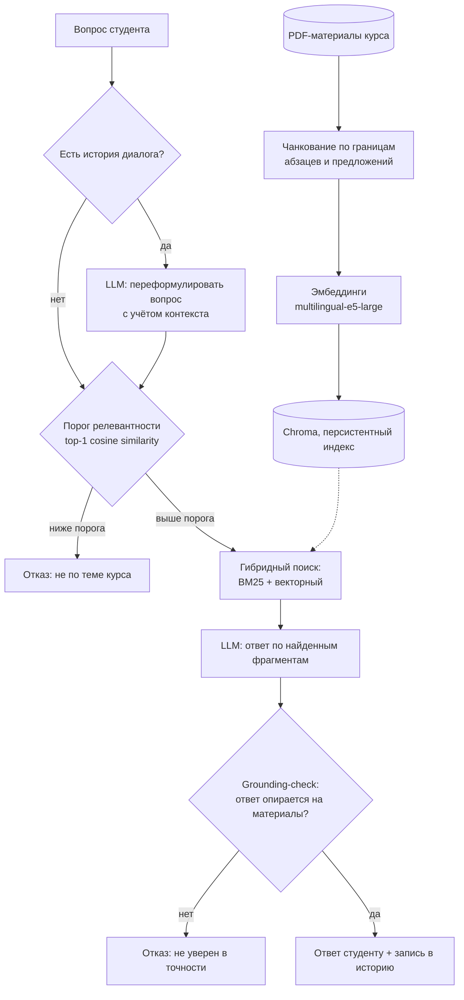

# 🎓 Course Tutor Bot

**RAG-репетитор для Telegram: отвечает на вопросы студентов по материалам курса и объясняет их простым языком.**

[](https://github.com/kelis234-eng/course-tutor-bot/actions/workflows/tests.yml)


[](LICENSE)

---

## О проекте

Студенты задают вопросы по курсу, а бот отвечает на основе загруженных PDF-материалов. Ответ формируется с использованием найденных фрагментов документов. Для снижения риска недостоверных ответов реализованы три механизма:

1. **Retrieval вместо дообучения.** Модель находит нужные фрагменты материалов и объясняет их своими словами. При замене PDF можно использовать систему для другого курса без повторного обучения модели.
2. **Порог релевантности.** Вопросы, далёкие от материалов курса, могут отсеиваться до обращения к LLM. Порог настраивается и требует калибровки под embedding-модель (см. [«Ограничения»](#ограничения)).
3. **Grounding-check.** Отдельный вызов LLM проверяет, опирается ли готовый ответ на найденные материалы.

Проект представляет собой ML-инженерный пайплайн: от выбора схемы retrieval до тестов без GPU и диагностики проблем при развёртывании (конфликты версий CUDA, multiprocessing в vLLM, ограничения Telegram API).

---

## Как отвечает бот

| Что пишет студент | Что делает бот |
|---|---|
| `/start` | Здоровается и сбрасывает историю диалога |
| Вопрос по теме курса | Находит релевантные фрагменты и объясняет тему своими словами |
| Уточнение («а что насчёт второго пункта?») | Учитывает предыдущие реплики: переформулирует вопрос в самостоятельный и ищет заново |
| Вопрос не по теме («рецепт борща») | Может отказаться от ответа по результатам проверки релевантности или обоснованности |
| Длинный ответ | Делит на несколько сообщений по границам абзацев (лимит Telegram — 4096 символов) |

---

## Архитектура



Каждый вызов LLM (переформулировка, генерация, grounding-check) обёрнут в `safe_llm_call`: отдельный поток, таймаут и перехват исключений. При сбое или превышении времени ожидания бот возвращает fallback-сообщение.

---

## Ключевые решения

**Гибридный поиск (BM25 + вектор).** BM25 находит точные термины, аббревиатуры и числа. Векторный поиск учитывает смысл запроса при другой формулировке. Результаты объединяет `EnsembleRetriever` с весами 0.4 / 0.6.

**Эмбеддинги `intfloat/multilingual-e5-large`.** Используются `transformers.AutoModel`, mean-pooling, нормализация и префиксы `query:` / `passage:`.

**Чанкование с учётом структуры.** `RecursiveCharacterTextSplitter` режет сначала по абзацам, затем по предложениям и словам. Перед этим нормализуются переносы строк. Чанки короче 80 символов отбрасываются как шум.

**Косинусная метрика.** Для Chroma явно задана метрика `hnsw:space = cosine`, чтобы обеспечить предсказуемую работу similarity score и порога релевантности.

**Персистентный индекс.** Хэш PDF-файлов в папке материалов позволяет определить, требуется ли пересборка индекса после изменения документов.

**Асинхронный старт.** Чтение PDF, расчёт эмбеддингов и загрузка LLM выполняются в фоне. Бот отвечает на `/start` сразу и сообщает, что материалы ещё готовятся.

**Память диалога.** История хранится в `context.user_data`, глубина по умолчанию — 4 реплики.

**Структурированные логи.** События (загрузка модели, вызов LLM, отказ по порогу, сбой) записываются в JSONL-файл `logs_out.jsonl` и консоль.

---

## Параметры по умолчанию

Значения из кода; переопределяются в `configs/settings.ini`.

| Секция | Параметр | По умолчанию |
|---|---|---|
| `[Model]` | `model` | `t-tech/T-lite-it-1.0` |
| `[Model]` | `temperature` / `top_p` / `top_k` | 0.5 / 0.9 / 50 |
| `[Model]` | `max_new_tokens` | 768 |
| `[Model]` | `llm_timeout_seconds` | 30 |
| `[Model]` | `quantization`, `max_model_len` | отключено |
| `[RAG]` | `chunk_size` / `chunk_overlap` / `top_k` | 1200 / 200 / 6 |
| `[Hybrid]` | `bm25_weight` / `vector_weight` | 0.4 / 0.6 |
| `[Hybrid]` | `relevance_threshold` | 0.35 |
| `[VectorStore]` | `embedding_model` | `intfloat/multilingual-e5-large` |
| `[VectorStore]` | `persist_directory` | `chroma_db` |
| `[Memory]` | `history_max_turns` | 4 |
| `[Course]` | `name` | `курс` |

---

## Стек

| Категория | Технологии |
|---|---|
| LLM | vLLM; `t-tech/T-lite-it-1.0` (основная конфигурация), `Qwen/Qwen2.5-3B-Instruct` (Colab) |
| Оркестрация | LangChain (`core`, `community`, `chroma`, `text-splitters`) |
| Retrieval | Chroma + `rank_bm25`, `EnsembleRetriever` |
| Эмбеддинги | `intfloat/multilingual-e5-large`, `transformers`, `torch` |
| Документы | `pypdf` |
| Интерфейс | `python-telegram-bot` (async, polling) |
| Тесты и CI | `pytest`, интеграционный тест на фейковых LLM и эмбеддингах, GitHub Actions |

---

## Структура репозитория

```text
course-tutor-bot/
├── main.py
├── configs/
│   ├── settings.ini
│   └── settings_colab.ini
├── notebooks/
│   └── course_tutor_bot_colab.ipynb
├── tests/
│   ├── test_basic.py
│   └── verify_pipeline_no_gpu.py
├── .github/workflows/tests.yml
├── requirements.txt
├── .env.example
└── LICENSE
```

Весь код находится в `main.py` и разделён на логические секции: конфигурация, документы, эмбеддинги, индекс, retrieval, LLM, модерация и Telegram.

---

## Быстрый старт

### Основная конфигурация

**Требования:** Linux (или WSL2), Python 3.10+, видеокарта NVIDIA с CUDA, токен бота от [@BotFather](https://t.me/BotFather).

Модель `T-lite-it-1.0` имеет около 8 млрд параметров: в bf16 ей требуется порядка 24 ГБ VRAM. При использовании квантования требования к видеопамяти ниже.

```bash
git clone https://github.com/kelis234-eng/course-tutor-bot.git
cd course-tutor-bot

python -m venv venv
source venv/bin/activate
pip install -r requirements.txt

cp .env.example .env
mkdir -p MATERIALS

python main.py --config configs/settings.ini
```

В `.env` необходимо указать `BOT_TOKEN`. PDF-материалы курса нужно положить непосредственно в папку `MATERIALS/`.

### Google Colab

Откройте `notebooks/course_tutor_bot_colab.ipynb` на [Google Colab](https://colab.research.google.com), включите GPU (`Runtime → Change runtime type`), добавьте секрет `BOT_TOKEN` и выполните ячейки по порядку.

Отличия от основной конфигурации (`configs/settings_colab.ini`): используется модель меньшего размера (`Qwen2.5-3B-Instruct`), а эмбеддинги рассчитываются на CPU для экономии VRAM. Логика RAG, памяти и модерации сохраняется.

---

## Тестирование

Оба уровня тестирования работают без GPU и без загрузки весов.

```bash
# Юнит-тесты
pip install pytest
pytest tests/test_basic.py -v

# Интеграционный тест
pip install langchain langchain-community langchain-chroma rank_bm25 \
            langchain-text-splitters chromadb fpdf2
python tests/verify_pipeline_no_gpu.py
```

Интеграционный тест использует сгенерированные PDF, фейковые LLM и эмбеддинги. Он проверяет управляющую логику пайплайна, но не измеряет качество поиска и ответов на реальной модели.

Оба набора тестов запускаются через GitHub Actions при push и pull request.

> Интеграционный скрипт создаёт в текущей папке `MATERIALS/` и `chroma_db_test/` и удаляет их по окончании. Запускайте его в чистой копии репозитория, а не рядом с настоящими материалами курса.

---

## Инженерные решения и отладка

В ходе развёртывания в Google Colab были выявлены и решены следующие проблемы:

| Симптом | Причина | Решение |
|---|---|---|
| `ModuleNotFoundError: EnsembleRetriever` | В LangChain 1.x класс переехал в `langchain_classic` | Fallback-импорт |
| Порог релевантности работал непредсказуемо | Chroma по умолчанию использовала L2 | Явно задана косинусная метрика |
| Несовпадение CUDA в PyTorch и TorchAudio | Различия версий CUDA в окружении | Пакет-заглушка и настройка `PYTHONPATH` |
| `CUDA out of memory` | Параметры vLLM передавались некорректно | Передача через `vllm_kwargs` |
| `Cannot re-initialize CUDA in forked subprocess` | Проблема multiprocessing в vLLM | Принудительная установка `spawn` |
| Ответ не помещался в сообщение Telegram | Ограничение в 4096 символов | Разбиение через `split_for_telegram()` |

---

## Ограничения

- До трёх LLM-вызовов на вопрос (переформулировка, генерация, grounding-check), что увеличивает задержку.
- `relevance_threshold = 0.35` пока не откалиброван на размеченном наборе вопросов. Для E5 это значение может быть слишком низким и недостаточно отсеивать нерелевантные запросы.
- Сообщения обрабатываются последовательно: пока бот готовит ответ одному студенту, остальные ждут.
- Память диалога хранится в процессе, после перезапуска история теряется.
- vLLM требует GPU; для CPU-only потребуется другой backend (например, `llama-cpp-python`).
- Хэш индекса учитывает только PDF в корне `MATERIALS/`.
- Качество retrieval и генерации пока не измерено на размеченном наборе вопросов.

---

## Лицензия

[MIT](LICENSE)
